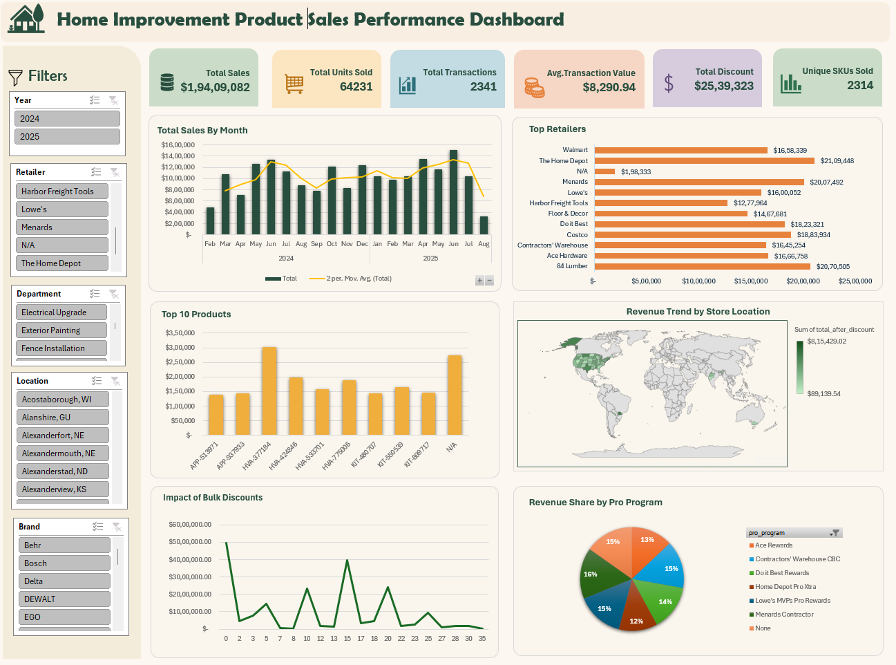

# Home Improvement Product Sales Dashboard

**🌟 Project Overview**

The Home Improvement Product Sales Performance Dashboard is an Excel-based data analytics project designed to analyze sales performance across home improvement products, retailers, store locations, departments, brands, and Pro Program categories.

The dashboard transforms raw sales data into an interactive visual report that helps users explore revenue trends, identify top-performing retailers and products, understand discount patterns, and compare sales performance across different dimensions.

Interactive slicers allow users to filter the dashboard by Year, Retailer, Department, Location, and Brand, making it easier to investigate specific segments and evaluate business performance.

**📊 Business Problem**

Businesses selling home improvement products need to understand which products and retailers generate the most revenue, how sales change over time, and how discounts affect overall sales performance.

Analyzing raw transaction data manually can make it difficult to identify trends and compare performance across multiple business categories.

This project addresses that challenge by presenting key sales metrics and interactive visualizations in a single dashboard.

**🎯 Key Objectives**

1.Monitor overall sales performance using key performance indicators (KPIs).

2.Analyze monthly sales trends across 2024 and 2025.

3.Identify top-performing retailers based on sales revenue.

3.Compare sales performance across individual products and SKUs.

4.Explore revenue distribution across store locations.

5.Examine the relationship between bulk discounts and sales performance.

6.Analyze revenue share across different Pro Program categories.

7.Enable interactive analysis using Excel slicers.

**📁 Data Source**

**Source:** https://www.kaggle.com/datasets/pratyushpuri/big-box-home-improvement-bulk-discount-sales-2025

**📝 Tools and Technologies**

1.Microsoft Excel - Data preparation, calculations, KPI development, PivotTables, PivotCharts, slicers, and dashboard design.

2.Excel formulas - Calculation of sales metrics, discounts, and performance indicators.

3.PivotTables and PivotCharts - Aggregation and visualization of sales data.

**🚀 Key Performance Indicators (KPIs)**

The dashboard includes six primary KPIs:

1.Total Sales

2.Total Units Sold

3.Total Transactions

4.Average Transaction Value

5.Total Discount

6.Unique SKUs Sold

**📈  Dashboard Visualizations**

**✅ Conclusion**

The dashboard supports data-driven decisions by helping businesses identify top-performing retailers and products, monitor sales trends, evaluate discount patterns, and understand revenue distribution to improve sales strategies and business performance.